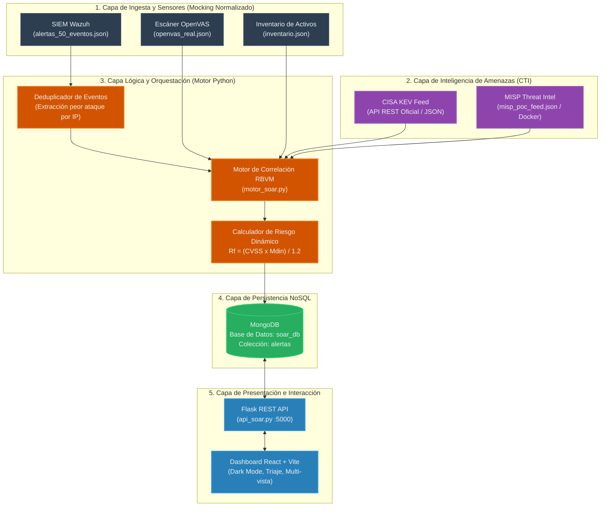

# Diseño e Implementación de una Prueba de Concepto para la Priorización de Vulnerabilidades en Centros de Operaciones de Seguridad (SOC)

[](https://www.python.org/)
[](https://flask.palletsprojects.com/)
[](https://react.dev/)
[](https://www.mongodb.com/)
[](https://www.docker.com/)
[]()

> **Trabajo de Titulación para optar al título de Ingeniero Civil Informático**  
> **Autor:** Jorge Eduardo Álvarez Alarcón (`jorge.alvareza@estudiantes.uv.cl`)  
> **Profesor Guía:** Cristian Carrión  
> **Institución:** Escuela de Ingeniería Informática, Facultad de Ingeniería, Universidad de Valparaíso, Chile  
> **Fecha:** Octubre 2026  

---

## 1. Título del Proyecto

**Diseño e Implementación de una Prueba de Concepto para la Priorización de Vulnerabilidades en Centros de Operaciones de Seguridad**  
*(A Proof-of-Concept Design and Implementation for Contextual Vulnerability Prioritization in Security Operations Centers)*

---

## 2. Descripción del Problema y Solución Propuesta

### 2.1. El Problema: Fatiga de Alertas y Saturación del SOC

Los Centros de Operaciones de Seguridad (**SOC**) modernos enfrentan una crisis operacional provocada por la **fatiga de alertas** (*alert fatigue*):
* **Volumen desbordante y ruido operacional:** Los analistas se ven inundados por miles de alertas diarias (~10.000 alertas/día en organizaciones medianas y grandes), donde entre un 40% y 42% corresponden a falsos positivos o eventos de baja relevancia táctica.
* **Silos de información y fragmentación:** La infraestructura de defensa opera de manera desconectada. Las herramientas SIEM (ej. Wazuh), los escáneres de vulnerabilidades estáticas (ej. OpenVAS / Greenbone), las plataformas de inteligencia de amenazas (CTI) y el inventario de activos no dialogan entre sí.
* **Insuficiencia del estándar CVSS estático:** Tradicionalmente, la industria prioriza incidentes basándose exclusivamente en la severidad base intrínseca (*Common Vulnerability Scoring System - CVSS*). Sin embargo, una vulnerabilidad con CVSS 10.0 en un servidor de pruebas aislado sin exposición a internet no representa la misma urgencia organizacional que un CVSS 7.5 en una base de datos central que está recibiendo ataques de fuerza bruta o inyecciones SQL en tiempo real.
* **Sobrecarga cognitiva y correlación manual:** Un analista invierte entre 9 y 15 minutos por alerta para correlacionar manualmente la IP afectada, consultar el inventario, verificar si existe un exploit activo en catálogos globales y revisar los logs del SIEM. Para un lote modesto de 50 incidentes, este triaje manual requiere entre 5 y 7.5 horas de trabajo humano ininterrumpido, lo que genera retrasos críticos en el *Mean Time to Respond* (MTTR) y propicia que vulnerabilidades críticas pasen desapercibidas.

### 2.2. Solución Propuesta: Motor RBVM + Principios SOAR

Para mitigar esta problemática, se diseñó e implementó una **Prueba de Concepto (PoC)** de un motor lógico centralizado de priorización basado en dos pilares fundamentales:

1. **Principios de Orquestación SOAR (*Security Orchestration, Automation, and Response*):** Integración y normalización automática de datos heterogéneos procedentes de telemetría en vivo (Wazuh SIEM), escaneos estructurales latentes (OpenVAS), inventario de activos y fuentes globales de CTI (*Cyber Threat Intelligence*).
2. **Modelo RBVM (*Risk-Based Vulnerability Management*):** Un modelo matemático determinístico y trazable que reemplaza la priorización ciega por un cálculo de riesgo dinámico contextualizado.

#### Modelo Matemático de Atenuación de Riesgo
Basado en las recomendaciones de **ISO/IEC 27005:2022** y adaptando los principios de toma de decisiones de **SSVC** (*Stakeholder-Specific Vulnerability Categorization* de CISA / Carnegie Mellon), el motor calcula un **Multiplicador Dinámico ($M_{din}$)** compuesto por tres variables ponderadas:

$$M_{din} = (E_o \times 0.45) + (C_a \times 0.35) + (I_t \times 0.20)$$

El **Riesgo Final ($R_f$)** resultante se normaliza mediante la ecuación:

$$R_f = \frac{\text{CVSS} \times M_{din}}{1.2}$$

Donde:
* **$\text{CVSS} \in [0.0, 10.0]$:** Severidad técnica intrínseca proporcionada por OpenVAS.
* **$E_o$ (Evidencia Operativa Local - 45% peso):** Telemetría de ataques observada en el SIEM Wazuh:
  * `0.5` (Limpio): Sin alertas operacionales concurrentes dirigidas al activo.
  * `0.8` (Sospechoso): Alertas de severidad baja o media (`rule.level` entre 5 y 9).
  * `1.2` (Comprometido): Alertas críticas indicativas de ataque activo (`rule.level` $\ge$ 10).
* **$C_a$ (Criticidad del Activo - 35% peso):** Relevancia del activo para la misión de la organización:
  * `0.5` (Baja): Entornos de pruebas / calidad (QA) aislados.
  * `0.8` (Media): Estaciones de trabajo estándar de usuarios.
  * `1.0` (Alta): Servidores web y de aplicaciones en producción.
  * `1.2` (Crítica): Servidores centrales de base de datos y control de accesos.
* **$I_t$ (Inteligencia de Amenazas Global - 20% peso):** Estado de explotación pública:
  * `0.5` (Teórica): Sin evidencia pública de explotación activa.
  * `0.8` (PoC): Existencia de prueba de concepto pública registrada en MISP.
  * `1.2` (Activa): Vulnerabilidad presente en el catálogo oficial de explotación **CISA KEV** (*Known Exploited Vulnerabilities*).
* **Divisor $1.2$:** Representa el **límite máximo analítico** de la ecuación ($1.2 \times [0.45 + 0.35 + 0.20] = 1.2$). Garantiza matemáticamente que $R_f$ jamás sobrepase $10.0$ y confirma que el algoritmo actúa como un **atenuador determinístico de ruido operacional**, degradando la prioridad de hallazgos en activos no críticos o sin ataques detectados.

---

## 3. Arquitectura del Sistema

La solución adopta una **arquitectura modular desacoplada por capas**, orientada a garantizar reproducibilidad analítica, bajo acoplamiento y procesamiento asíncrono.

### 3.1. Diagrama de Arquitectura de Alto Nivel



### 3.2. Descripción de Capas Funcionales

1. **Capa de Ingesta y Mocking Estructurado:**
   * Ingesta extractos JSON con esquemas canónicos de Wazuh (alertas en formato de eventos por línea con `rule.level`), reportes de OpenVAS (con identificadores CVE y puntuación CVSS) y metadatos organizacionales de activos ($C_a$).
   * Diseñada bajo un esquema de *mocking* para independizar los ensayos experimentales de la variabilidad o latencia de red de entornos de producción.
2. **Capa de Inteligencia de Amenazas (CTI):**
   * Consulta en tiempo real contra el catálogo gubernamental **CISA KEV** mediante petición HTTP directa.
   * Conexión auxiliar y soporte local de feeds **MISP** (desplegable en Docker) para correlacionar vectores de prueba de concepto públicos.
3. **Capa Lógica del Orquestador (`motor_soar.py`):**
   * Agrupa y deduplica eventos del SIEM extrayendo el mayor nivel de ataque registrado por host.
   * Cruza la tupla $(IP, CVE)$ con el inventario corporativo y los feeds CTI.
   * Aplica la fórmula heurística calculando $M_{din}$ y $R_f$, asignando la etiqueta de riesgo inicial (`Detectada`).
4. **Capa de Persistencia NoSQL (MongoDB):**
   * Modela los incidentes correlacionados como documentos JSON jerárquicos desnormalizados, eliminando la rigidez de las bases de datos relacionales y soportando esquemas heterogéneos de telemetría.
5. **Capa de Presentación y Triaje (`api_soar.py` & React Dashboard):**
   * Expone endpoints REST para ejecución del motor, consulta con ordenamiento descendente por $R_f$, transición de estados transaccionales (`Detectada` $\rightarrow$ `En Triaje` $\rightarrow$ `Finalizada`) y remediación.
   * Proporciona un Dashboard interactivo con **conmutación dinámica de tres modos de visualización** para contrastar empíricamente la efectividad del modelo frente a las líneas base:
     * **Modo LB1:** Ordenamiento técnico tradicional por CVSS Base.
     * **Modo LB2:** Ordenamiento contextual simplificado ($CVSS \times C_a$).
     * **Modo RBVM:** Ordenamiento heurístico completo con telemetría y CTI.

---

## 4. Tecnologías Utilizadas

| Componente | Tecnología / Librería | Versión | Rol en la Solución |
| :--- | :--- | :--- | :--- |
| **Lenguaje Core** | Python | 3.10+ | Lógica de orquestación, ingestión, deduplicación y cálculo numérico |
| **API REST** | Flask / Flask-CORS | 3.0+ | Microservicio para exponer los datos del motor al cliente web |
| **Base de Datos** | MongoDB | 6.0+ | Almacenamiento orientado a documentos para registrar las alertas enriquecidas |
| **Conector NoSQL**| PyMongo | 4.6+ | Interacción síncrona entre Python y MongoDB |
| **Frontend Framework** | React.js | 18.x | Interfaz SPA reactiva para el analista de seguridad |
| **Build Tool UI** | Vite | 5.x | Entorno de desarrollo rápido y empaquetado del Frontend |
| **Iconografía UI** | Lucide React | 0.400+ | Simbología e indicadores de alerta para el Dashboard SOC |
| **Inteligencia CTI** | CISA KEV API | v1 (Feed) | Catálogo oficial de vulnerabilidades explotadas conocidas en la naturaleza |
| **Plataforma CTI** | MISP Docker | Core Latest| Orquestación de inteligencia de malware y feeds comunitarios |
| **Virtualización** | Docker Compose | 2.x | Despliegue de servicios auxiliares (MISP, MariaDB, Redis) |
| **Fuentes de Datos** | Wazuh & OpenVAS | Mocks JSON | Simulación estructurada de telemetría SIEM y escáneres de vulnerabilidades |

---

## 5. Estructura del Repositorio

```text
tesis_soar/
├── Docs/                                                 # Documentación académica y de evaluación
│   ├── InformeSeminario.pdf                              # Informe final de Seminario de Título II (Octubre 2026)
│   ├── _ICI_INF__Template_Proyecto_Seminario_2.pdf       # Plantilla y borrador intermedio de investigación
│   ├── Evaluación Informe 2 Seminario Título II.xlsx      # Rúbrica oficial de evaluación de informe escrito
│   ├── Evaluación Presentación 2 Seminario Título II.xlsx  # Rúbrica oficial de evaluación de defensa oral
│   ├── Revisión Informe Seminario 1.pdf                 # Retroalimentación docente sobre el diseño experimental
│   └── Revisión Informe Seminario 1 (1).pdf             # Anotaciones adicionales de revisión metodológica
│
├── infra/                                                # Scripts y configuraciones de infraestructura
│
├── misp_docker/                                          # Contenedores para plataforma de Inteligencia de Amenazas
│   └── docker-compose.yml                                # Despliegue de MISP Core, MariaDB 10.4 y Redis 6.2
│
├── src/                                                  # Código fuente de la solución
│   ├── backend/                                          # Motor lógico y microservicios Python
│   │   ├── api_soar.py                                   # Servidor REST Flask con endpoints de triaje y remediación
│   │   ├── motor_soar.py                                 # Algoritmo de correlación, cálculo de Mdin y descarga CTI
│   │   ├── alertas_50_eventos.json                       # [Dataset] Telemetría sintética generada por SIEM Wazuh
│   │   ├── openvas_real.json                             # [Dataset] Reporte de vulnerabilidades latentes (OpenVAS)
│   │   ├── inventario.json                               # [Dataset] Matriz de activos organizacionales y factor Ca
│   │   └── misp_poc_feed.json                            # [Dataset] Feed local de pruebas de concepto (CTI)
│   │
│   └── frontend/                                         # Dashboard de visualización e interacción SOC
│       ├── package.json                                  # Dependencias de Node.js (React, Lucide, Vite)
│       ├── vite.config.js                                # Configuración de empaquetado con Vite
│       ├── index.html                                    # Punto de entrada HTML5 del Dashboard
│       └── src/
│           ├── main.jsx                                  # Renderizado de React en el DOM
│           ├── App.jsx                                   # Componente central: tabla SOC, multi-vista y triaje
│           ├── App.css                                   # Estilos Dark Mode, badges de riesgo y animaciones
│           └── resultado_mongodb.json                    # Snapshot de referencia de la estructura documental
│
├── .gitignore                                            # Exclusiones de Git (entornos virtuales, caches, logs)
└── README.md                                             # Documentación principal del proyecto de investigación
```

---

## 6. Metodología Experimental y Validación

El proyecto se estructuró bajo la modalidad de **investigación aplicada**, contrastando hipótesis cuantificables frente a un marco de referencia independiente (*Ground Truth*).

### 6.1. Hipótesis de Investigación

* **Hipótesis Nula ($H_0$):** El modelo de priorización dinámico contextualizado no incrementa la precisión en la identificación de emergencias críticas organizacionales ni reduce la presencia de ruido operacional en las primeras posiciones del triaje respecto al modelo estático tradicional.
* **Hipótesis Alternativa ($H_1$):** El modelo de priorización dinámico propuesto incrementa significativamente la métrica $Precision@5$ y $Precision@10$, restituyendo la granularidad matemática y reduciendo el esfuerzo cognitivo de correlación manual requerido por los analistas del SOC.

### 6.2. Ground Truth y Marco de Referencia (SSVC)
Para evaluar la exactitud sin sesgos propios del algoritmo, los 20 CVEs de prueba fueron clasificados a priori mediante el árbol de decisiones del modelo **SSVC (*Stakeholder-Specific Vulnerability Categorization*)** impulsado por CISA y la Universidad Carnegie Mellon. Cada incidente fue catalogado en una de las cuatro decisiones canónicas: `Track`, `Track*`, `Attend` o `Act` (Emergencia táctica).

### 6.3. Comparación de Resultados Frente a Líneas Base

Se contrastó el **Modelo RBVM propuesto** frente a dos modelos de referencia:
1. **Línea Base 1 (LB1 - Solo CVSS Base):** Ordenamiento tradicional de la industria.
2. **Línea Base 2 (LB2 - $CVSS \times C_a$):** Ordenamiento ponderado únicamente por la criticidad del activo.

| Métrica | Línea Base 1 (Solo CVSS) | Línea Base 2 ($CVSS \times C_a$) | Modelo Propuesto (RBVM) | Interpretación del Resultado |
| :--- | :---: | :---: | :---: | :--- |
| **Precision@5** | **80%** (4 `Act`) | **100%** (5 `Act`) | **100%** (5 `Act`) | El modelo propuesto aísla el 100% de las emergencias críticas en el Top 5 sin empates. |
| **Granularidad en Top 5** | Regular (Puntajes repetidos) | **Nula** (5 empates en 10.00) | **Restaurada** (10.00, 9.80, 9.23, etc.) | LB2 colapsa impidiendo decidir; RBVM diferencia la urgencia mediante telemetría. |
| **Precision@10** | **60%** (6 `Act`) | **90%** (9 `Act`) | **70%** (7 `Act`) | Balance matemático: se prioriza un ataque real sobre un CVE de prueba con CVSS 10. |
| **Supresión de Ruido** | **Nula** (CVE de pruebas en pos. 4) | **Ciega** (Ignora telemetría activa) | **Equilibrada** (Atenuación determinística) | El ruido de laboratorios se degrada a la zona inferior de la cola sin perder trazabilidad. |

### 6.4. Evaluación Analítica de Carga de Trabajo
* **Triaje manual tradicional:** Un lote de 50 eventos operacionales exige entre **5.0 y 7.5 horas** de revisión manual por analista humano (asumiendo 9 a 15 minutos por alerta para corroborar IP, escáner, catálogo CISA y nivel de logs).
* **Triaje automatizado con RBVM:** El motor ejecuta la deduplicación, el enriquecimiento con CTI en vivo y la normalización matemática en **$< 1.5$ segundos** de cómputo local, entregando una cola de incidentes clasificada que reduce radicalmente el esfuerzo de correlación manual previo a la toma de decisiones.

---

## 7. Guía de Instalación y Puesta en Marcha

### 7.1. Requisitos Previos de Infraestructura

* **Sistema Operativo:** Linux (probado en Ubuntu 22.04 LTS / Debian 12)
* **Hardware Mínimo:** 4 vCores, 8 GB de RAM, 100 GB de disco SSD
* **Software Base:**
  * Python 3.10 o superior y administrador de paquetes `pip`
  * Node.js v18.x o superior y gestor `npm`
  * MongoDB Community Server v6.0+ en ejecución local (puerto `27017`)
  * Docker y Docker Compose v2.0+ (opcional, para stack MISP)

---

### 7.2. Paso 1: Configurar la Capa de Datos (MongoDB)

Asegúrate de que el servicio de MongoDB esté iniciado en tu entorno local:

```bash
# Iniciar MongoDB en sistemas basados en systemd (Ubuntu/Debian)
sudo systemctl start mongod
sudo systemctl enable mongod

# Comprobar que MongoDB escucha en el puerto por defecto (27017)
mongosh --eval "db.adminCommand('ping')"
```

---

### 7.3. Paso 2: Configurar y Ejecutar el Backend (Python + Flask)

1. Crear y activar un entorno virtual dentro de la raíz o carpeta `src/backend`:
   ```bash
   cd src/backend
   python3 -m venv .venv
   source .venv/bin/activate
   ```

2. Instalar las dependencias requeridas:
   ```bash
   pip install flask flask-cors pymongo requests
   ```

3. Iniciar la API REST del orquestador:
   ```bash
   python3 api_soar.py
   ```
   *El microservicio quedará a la escucha en `http://localhost:5000`.*

---

### 7.4. Paso 3: Configurar y Ejecutar el Frontend (React + Vite)

1. En una nueva terminal, acceder a la carpeta del cliente web e instalar paquetes:
   ```bash
   cd src/frontend
   npm install
   ```

2. Iniciar el servidor de desarrollo Vite:
   ```bash
   npm run dev
   ```
   *La aplicación estará accesible en el navegador en `http://localhost:5173`.*

---

### 7.5. Paso 4: (Opcional) Levantar Plataforma MISP en Docker

Si se desea interactuar con un entorno de inteligencia de amenazas local:

```bash
cd misp_docker
docker compose up -d
```
*MISP Core estará disponible en `http://localhost:8080` (Credenciales por defecto: `admin@admin.test` / `admin`).*

---

## 8. Manual de Usuario del Dashboard SOAR

1. **Ejecutar Triaje:**
   * Haz clic en el botón superior **`Ejecutar Triaje`**. El Backend descargará el feed oficial de CISA KEV, deduplicará los logs de Wazuh, correlacionará con OpenVAS y poblará MongoDB.
2. **Alternar Modos de Visualización (Estudio Comparativo):**
   * Presiona el botón dinámico **`Vista: Modelo RBVM`** para alternar entre:
     * `Vista: LB1 (Solo CVSS)`: Analiza el ordenamiento tradicional sin contexto.
     * `Vista: LB2 (CVSS x Ca)`: Comprueba la colisión de puntajes críticos.
     * `Vista: Modelo RBVM`: Observa la priorización contextual final y cómo se encienden los indicadores de telemetría y CTI.
3. **Flujo de Triaje de Alertas:**
   * **Nuevas (`Detectada`):** Incidentes recién ingestados.
   * **Avanzar Estado (`En Triaje`):** Pasa la alerta a etapa de investigación activa.
   * **Finalizar / Remediar:** Actualiza el ciclo transaccional o remueve el incidente mitigado.
4. **Filtros Rápidos:**
   * Emplea los botones de la cabecera (`Global`, `Nuevas`, `En Triaje`, `Finalizadas`) para segmentar la cola de trabajo del analista.

---

## 9. Limitaciones y Líneas de Trabajo Futuro

### 9.1. Limitaciones Identificadas
* **Correlación a nivel de Host (IP):** El motor eleva el factor operativo ($E_o$) de todas las vulnerabilidades alojadas en un activo si este recibe un ataque, aunque el evento del SIEM no coincida exactamente con el servicio o puerto del CVE reportado.
* **Pesos Heurísticos:** Los coeficientes ($0.45, 0.35, 0.20$) fueron determinados heurísticamente con base en la literatura y principios de ciberdefensa, sin someterse aún a un proceso de calibración estadística supervisada con analistas SOC en producción.
* **Mocking de Ingesta:** La ingesta de datos operacionales se implementó mediante archivos JSON normalizados para asegurar la reproducibilidad académica en laboratorio, en lugar de conectores síncronos hacia APIs en producción.
* **Alcance Orientado al Triaje:** La plataforma se centró en la fase analítica de priorización contextual y no incluyó playbooks de contención intrusiva activa en red (ej. bloqueo dinámico en firewall).

### 9.2. Trabajo Futuro
1. **Granularidad de Mapeo Servicio/Puerto:** Desarrollar correlación enriquecida que enlace el vector de ataque del evento SIEM con el servicio/puerto específico reportado por el escáner de vulnerabilidades.
2. **Conectores Bidireccionales en Tiempo Real:** Reemplazar el esquema de mocking por integraciones directas vía webhooks y APIs síncronas contra Wazuh Manager y Greenbone Vulnerability Management (GVM).
3. **Playbooks de Respuesta Automatizada:** Extender la plataforma hacia un SOAR de ciclo completo mediante playbooks de remediación directa (aislamiento de red de hosts, revocación de credenciales, contención en endpoint).

---

## 10. Referencias Principales

1. **CISA / Carnegie Mellon SEI (2021).** *Stakeholder-Specific Vulnerability Categorization (SSVC) Version 2.0*. Cybersecurity and Infrastructure Security Agency.
2. **FIRST (2019).** *Common Vulnerability Scoring System v3.1: Specification Document*. Forum of Incident Response and Security Teams.
3. **ISO/IEC (2022).** *ISO/IEC 27005:2022 Information security, cybersecurity and privacy protection — Guidance on managing information security risks*. International Organization for Standardization.
4. **CISA (2024).** *Known Exploited Vulnerabilities (KEV) Catalog*. Cybersecurity and Infrastructure Security Agency.
5. **Gartner (2023).** *Market Guide for Security Orchestration, Automation and Response (SOAR)*. Gartner Research.
